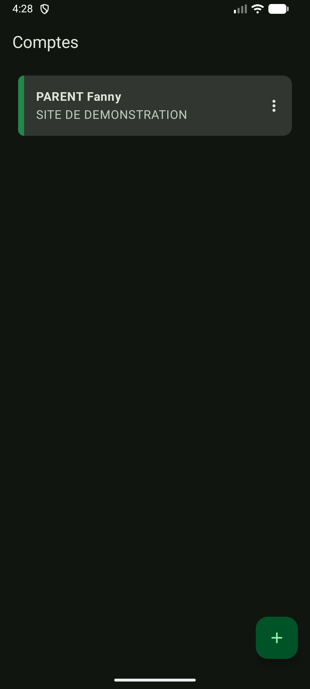
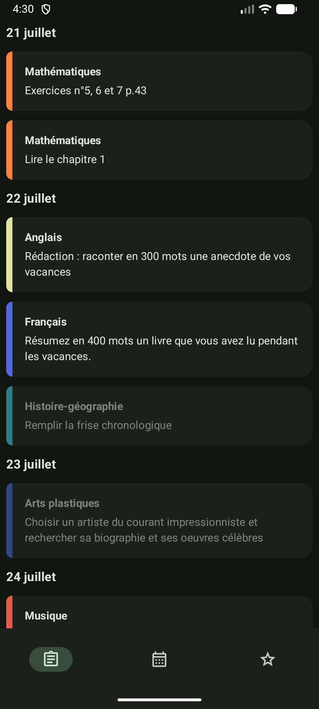
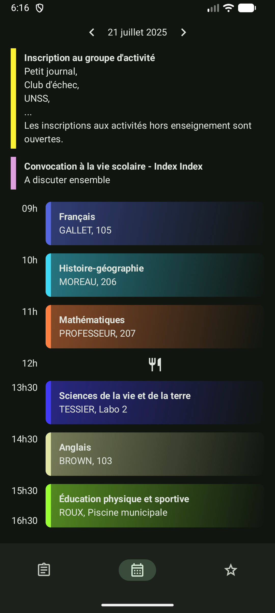
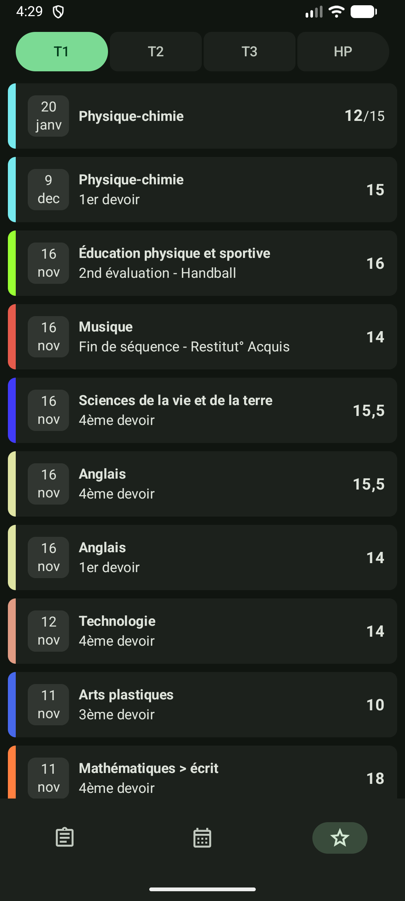

# Pralinote

> This project is not affiliated with PRONOTE nor Index Education

An unofficial native Android app that interacts with the french PRONOTE school website.
Only student profiles are supported for now.

Differences with the official mobile app and Papillon:
- modern Android interface
- runs on native code with better performance
- optimized for PRONOTE, makes as few requests as possible

## Screenshots

| Profile List |             Homework             |              Timetable              | Grades |
|:---:|:--------------------------------:|:-----------------------------------:|:---:|
|  |  |  |  |

## Features

- Multiple accounts, password login
- Homework (click on it to mark it as done/undone)
- Timetable with agenda integration
- Grades

Coming soon:
- QR code login
- Autoconnect
- Grade average, plots
- News

## Contributing

Internally, this app uses UniFFI with a modified version of [pronote-rs](https://github.com/FossKay/pronote-rs).
To build the app, you must have installed `cargo` (the rust toolchain) and a JDK (Java Development Kit).
[Android Studio](https://developer.android.com/studio) is recommended.

By default, on debug builds, the app uses sample data and shouldn't make any internet connections.
In `.../model/AppClient.kt`, toggle `NO_MOCK` on to modify this behaviour.

To bump the `pronote-rs` version, configure the `PRONOTE_RS` environment variable and set it
to the root folder of the project, then run `app/pronote-rs/update`.
Sometimes, manual changes to `p_client.rs` will be needed.

Run `./gradlew assembleDebug` to build a debug version of the app.