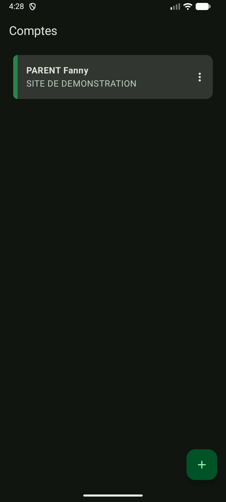
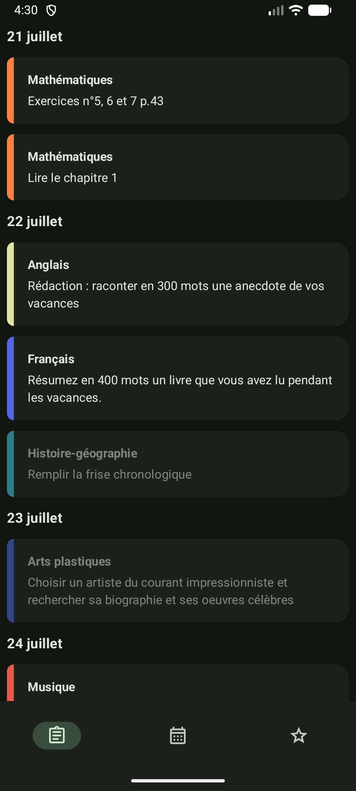
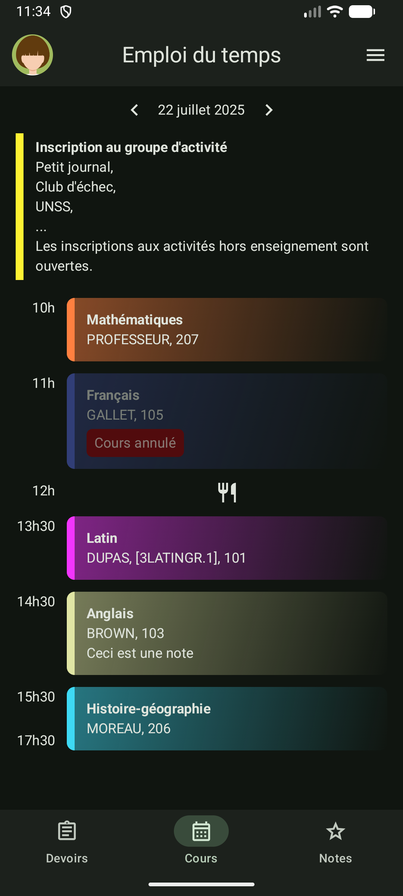
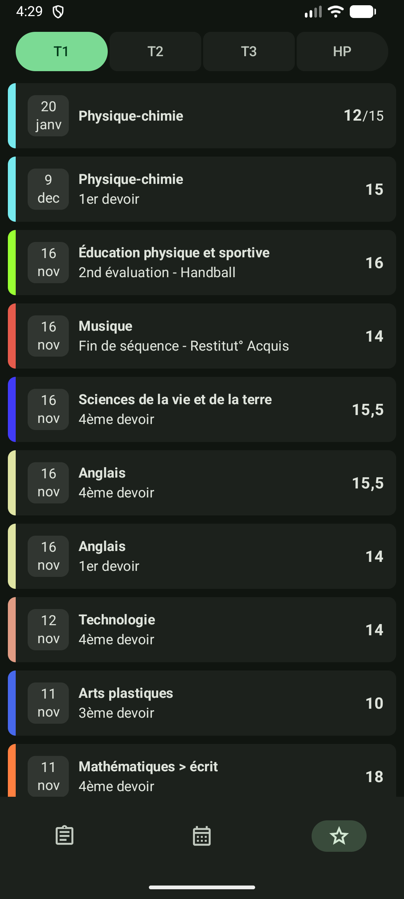

# Pralinote

> Ce projet n'est pas affilié avec PRONOTE ou Index Education

Une application native Android non officielle qui interagit avec le service scolaire PRONOTE.
Pour l'instant, seuls les comptes élèves fonctionnent.

Les différences par rapport à l'appli officielle et Papillon:
- une interface moderne Android
- s'exécute sur du code natif beaucoup plus performant
- optimisée pour PRONOTE, fait le moins de requêtes possible

## Captures d'écran

| Comptes |             Devoirs             |              Emploi du temps              | Notes |
|:---:|:--------------------------------:|:-----------------------------------:|:---:|
|  |  |  |  |

## Fonctionnalités

- Plusieurs comptes, connexion avec un mot de passe et auto-connexion
- Devoirs (cliquez dessus pour marquer un devoir comme fait/non fait)
- Emploi du temps avec agenda intégré
- Notes

Arrive bientôt:
- Connexion avec un QR code
- Moyenne des notes et graphiques
- Actualités et sondages

## Contribuer

Cette application utilise UniFFI avec une version modifiée de [pronote-rs](https://github.com/FossKay/pronote-rs).
Pour compiler l'appli, vous devez avoir installé `cargo` (les outils de développement du language Rust)
et un JDK (Java Development Kit). L'utilisation d'[Android Studio](https://developer.android.com/studio)
est recommandée.

Par défaut, quand on compile l'application en mode debug, elle utilise des données factices et ne
doit faire aucune connexion internet. Pour modifier ce comportement, définissez `NO_MOCK` sur vrai
dans `.../model/AppClient.kt`.

Pour mettre à jour la version de `pronote-rs` utilisée, définissez la variable d'environnement
`PRONOTE_RS` à la location du dossier contenant le projet et lancez le script `app/pronote-rs/update`
(sur Linux). De temps en temps, des changements manuels à `p_client.rs` vont être nécessaires.

Pour compiler une version debug de l'application, exécutez `./gradlew assembleDebug`.
Pour l'instant, Linux est nécessaire pour compiler Pralinote (si vous voulez contribuez au projet,
vous pouvez rajouter `app/src/pronote-rs/build.bat` et modifier `app/build.gradle.kts`)

*A propos de l'IA*: l'usage de l'IA est autorisé MAIS tout le code doit être écrit à la main et compréhensible.

## Note sur PRONOTE
Index Education [a indiqué](https://www.index-education.com/fr/article-1760-recommandations-relatives-a-l-application-papillon.php) que tant qu'une application PRONOTE non officielle utilise un mot de passe renseigné volontairement par l'utilisateur, et qu'elle n'a aucune forme de monétisation, ce n'est pas interdit.
> Cette pratique n'est pas illégale en soi, car justifiée par le fait que l'utilisateur renseigne volontairement ses informations de connexion et aussi par le fait que \[l'application (Papillon)] n'a pas de finalité commerciale.